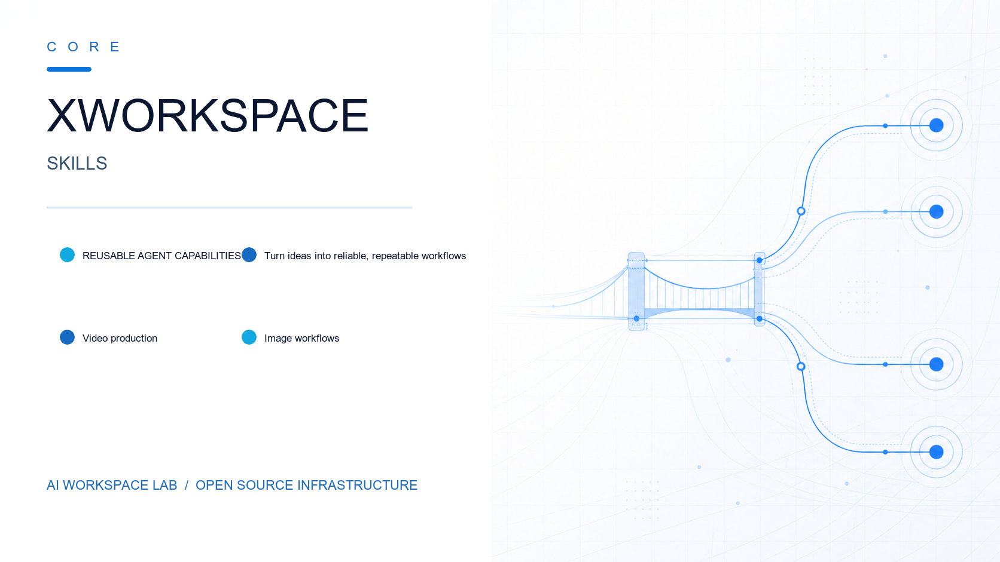
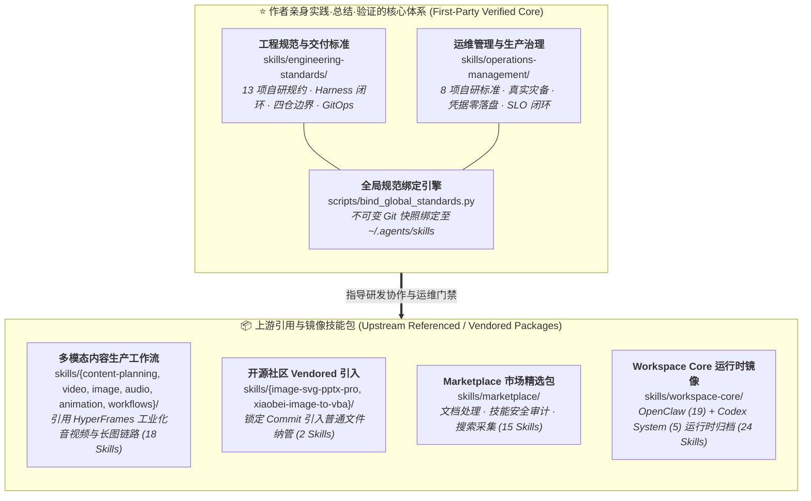

[](./LICENSE) [](https://www.python.org/) [](./skills/engineering-standards) [](./skills/workflows) [](./skills)

# XWorkspace Core Skills

一套面向 **XWorkmate / OpenClaw / Codex** 等 AI Workspace 的生产级规范体系与技能聚合库。

> [!IMPORTANT]
> ### 🎯 核心定位与架构原则
> 
> 本仓库的核心价值，在于沉淀作者在真实生产环境、多云架构与 AI Agent 团队协同中**亲身实践、深度总结、实战验证**的 **两大核心治理体系（共 21 项自研核心规范）**：
> 
> 1. ⭐ **[工程规范与交付标准 (`skills/engineering-standards/`)](skills/engineering-standards/)**（13 项自研核心工程规约）
> 2. ⭐ **[运维管理与基础设施治理 (`skills/operations-management/`)](skills/operations-management/)**（8 项自研生产级运维标准）
> 
> 配套自研了 **[版本化全局规范绑定引擎 (`scripts/bind_global_standards.py`)](scripts/bind_global_standards.py)**，通过 Git Detached Worktree 技术将上述 21 项验证标准以不可变快照锁定并注入本机 `~/.agents/skills`，彻底杜绝环境与分支切换漂移。
> 
> **除上述作者实践验证的两大核心规范体系外，仓库内的其余能力域（内容生产工作流、Marketplace 市场生态、OpenClaw/Codex 运行时包等）均为引用或镜像自上游开源社区与官方运行时的技能包**，作为统一 Workspace 的分发与使用聚合层。

---

## 📊 全盘扫描与更新结果概览

| 维度 | 扫描前（旧 README） | 扫描后（更新后） | 变动说明 |
|---|---|---|---|
| **纳管 Skill 总数** | 31 个 | **78 个** | 补全 47 个未在主索引体现的 Skill，建立 100% 完整覆盖清册 |
| **能力域分类** | 8 个（缺漏 marketplace） | **10 大能力域** | 补全 Marketplace 扩展与分类边界，确立自研核心与上游引用分层 |
| **工程规范 (Engineering)** | 12 个 | **13 个** | 重点突出：补全并置顶作者实战总结的 `zero-trust-overlay-delivery` 等 13 项规约 |
| **运维管理 (Operations)** | 仅文字提及 2 个，无表格 | **8 个完整导航表** | 重点突出：完整呈现作者生产验证的 8 项运维、灾备、凭据治理与 SLO 标准 |
| **市场扩展 (Marketplace)** | 0 个（完全缺失） | **15 个完整导航表** | 上游引用：补全 Office 文档处理、安全审查、Wan 多模态模型、实时翻译等 |
| **运行时核心 (Workspace Core)** | 仅简要文字说明，无清单 | **24 个（19 OpenClaw + 5 Codex）** | 上游镜像：建立完整的双层来源清册、导航索引与刷新机制 |
| **动图预览与素材** | sound-fx 标为“暂无预览” | **修复真实动图预览** | 链接至仓库中已存在的真实动图 `preview-sound-fx-for-video.gif` |
| **单元测试与门禁验证** | - | **10 项测试全通过** | 运行全量单元测试，确认视频构建脚本与全局绑定工具健康度 100% |

---

## 仓库架构全景：实践验证核心 vs 上游引用生态



---

## 🌟 核心重点一：工程规范与交付标准（`skills/engineering-standards/`）

👉 **目录直达**：[`skills/engineering-standards/`](skills/engineering-standards/)

这是作者在长期的生产级开发与多 Agent 协作中，**亲身实践、深度总结、实战验证的 13 项硬核研发规约**。每一项标准都对应着真实研发过程中的明确痛点与硬性验收门禁：

| 规范名称 | 解决的实战痛点与核心机制 | 规范入口 |
|---|---|---|
| **Agent Harness 工作流** | **研发主控总线**：定义「工程闭环 × 小步快跑」核心循环，统一驱动自测、代码审查、CI/CD 与多环境发布，是串联各项工程标准的唯一入口 | [`skills/engineering-standards/harness-workflow/SKILL.md`](skills/engineering-standards/harness-workflow/SKILL.md) |
| **Issue/PR 溯源与需求事实源** | **根治口头派活**：需求以 Issue 为唯一事实源，建立 `Issue → 分支 → commit → PR → CI → 部署 → Tag` 完整且可证伪的追溯链，禁止脱离 Issue 自主开工 | [`skills/engineering-standards/issue-pr-traceability-standard/SKILL.md`](skills/engineering-standards/issue-pr-traceability-standard/SKILL.md) |
| **工程开发规范** | **代码分支纪律**：分支命名矩阵、主干保护、PR 合并策略、不可变 Release Tag 规则，以及代码中不慎误提密钥时的标准化紧急撤回流程 | [`skills/engineering-standards/project-development-standard/SKILL.md`](skills/engineering-standards/project-development-standard/SKILL.md) |
| **CI/CD 工作流规约** | **消灭流水线假绿**：CI 构建与 CD 部署严格解耦、流水线脚本外置可复用、最小权限 GitHub OIDC 互信、不可变制品签名与假绿防治门禁 | [`skills/engineering-standards/ci-cd-workflow-spec/SKILL.md`](skills/engineering-standards/ci-cd-workflow-spec/SKILL.md) |
| **四边界执行归属迁移** | **消灭跨仓代码乱窜**：清晰划定 Toolkit、GitOps、IaC 与 Playbooks 四大代码仓的职责红线，提供「新增实现→切换调用→双向验证→清理旧副本」的安全迁移方法 | [`skills/engineering-standards/execution-ownership-migration/SKILL.md`](skills/engineering-standards/execution-ownership-migration/SKILL.md) |
| **多环境交付与发布** | **杜绝环境混淆与越权**：严格定义 SIT / UAT / Prod 多环境渐进交付路由规则，通过 GitHub OIDC → HashiCorp Vault 实现凭证与权限物理隔离 | [`skills/engineering-standards/multi-environment-delivery-and-release/SKILL.md`](skills/engineering-standards/multi-environment-delivery-and-release/SKILL.md) |
| **可重复代际升级验收** | **跨版本升级不翻车**：锁定升级版本候选，以阶段 0–7 规范执行新环境部署、单向数据对齐、真实业务回归与显式双向切换门禁 | [`skills/engineering-standards/generation-upgrade-acceptance/SKILL.md`](skills/engineering-standards/generation-upgrade-acceptance/SKILL.md) |
| **IaC 规约（iac_modules）** | **基础设施规范落地**：拓扑 YAML 驱动配置、Terraform Backend State 严格按环境隔离、保持 HCL 纯声明并与 CMDB 解耦 | [`skills/engineering-standards/infrastructure-as-code-spec/SKILL.md`](skills/engineering-standards/infrastructure-as-code-spec/SKILL.md) |
| **Config-as-Code 规约（playbooks）** | **主机配置零污染**：Ansible 剧本规范，强制 Vault-first 凭证零落盘、剧本幂等性设计与直接消费上游 IaC 产出 | [`skills/engineering-standards/config-as-code-spec/SKILL.md`](skills/engineering-standards/config-as-code-spec/SKILL.md) |
| **GitOps 唯一资源事实源** | **多云协同唯一源**：GitOps matrix 驱动 Hybrid、Selfhost、Serverless 部署，严格按 provider/account/state 隔离，禁止运行时 matrix 回退 | [`skills/engineering-standards/gitops-canonical-resource-delivery/SKILL.md`](skills/engineering-standards/gitops-canonical-resource-delivery/SKILL.md) |
| **AI 代理协作标准** | **人机协作底线保障**：AI Agent 团队的执行纪律与权限边界，工作区脏检查、越权拦截、错误自检与破坏性操作熔断 | [`skills/engineering-standards/ai-agent-collaboration-standard/SKILL.md`](skills/engineering-standards/ai-agent-collaboration-standard/SKILL.md) |
| **应用商店与初创扶持官网规范** | **踩坑血泪经验沉淀**：满足 Google（Startups / Play / Android）、Apple、Microsoft 真实性审核的官网设计、域名边界与部署后 post-check 自动化自检清单 | [`skills/engineering-standards/store-and-startup-homepage-spec/SKILL.md`](skills/engineering-standards/store-and-startup-homepage-spec/SKILL.md) |
| **零信任网络 Overlay 交付规约** | **云边协同安全互联**：XConnect Zero/Accounts、Gateway、One 客户端跨云网络互联、WireGuard-over-TLS 与鉴权审计 | [`skills/engineering-standards/zero-trust-overlay-delivery/SKILL.md`](skills/engineering-standards/zero-trust-overlay-delivery/SKILL.md) |

---

## 🌟 核心重点二：运维管理与基础设施治理（`skills/operations-management/`）

👉 **目录直达**：[`skills/operations-management/`](skills/operations-management/)

这是作者针对生产环境基础设施运维、灾备容灾与日常故障处理**深度总结和实战验证的 8 项生产标准**，让线上运维从被动救火走向确定性保障：

| 规范名称 | 解决的实战痛点与核心机制 | 规范入口 |
|---|---|---|
| **备份、恢复与数据迁移** | **数据不丢是唯一底线**：目标数据保护契约、异地恢复真实演练、历史故障强制回归验证、切换后增量补同步与严格 RPO/RTO 保障 | [`skills/operations-management/backup-disaster-recovery-and-data-migration/SKILL.md`](skills/operations-management/backup-disaster-recovery-and-data-migration/SKILL.md) |
| **事件响应与变更管理** | **从事故中沉淀免疫力**：生产故障分级响应、紧急变更通道、发布冻结期、无指责复盘（Blameless Postmortem）与必须落地可自动回归脚本 | [`skills/operations-management/incident-response-and-change-management/SKILL.md`](skills/operations-management/incident-response-and-change-management/SKILL.md) |
| **密钥、身份与访问治理** | **凭据彻底零落盘**：HashiCorp Vault policies/roles 治理、GitHub Actions OIDC 身份互信、最小权限原则、动态凭据定期轮转与一键紧急吊销 | [`skills/operations-management/secrets-identity-and-access-governance/SKILL.md`](skills/operations-management/secrets-identity-and-access-governance/SKILL.md) |
| **网络、DNS、TLS 与边缘管理** | **线上切流不中断**：权威 DNS 记录管理与 TTL 递减规划、ACME 证书自动化续期、Caddy/Ingress 反代配置与秒级流量回滚方案 | [`skills/operations-management/network-dns-tls-edge-management/SKILL.md`](skills/operations-management/network-dns-tls-edge-management/SKILL.md) |
| **可观测性、SLO 与告警规范** | **告别告警风暴**：SLI/SLO 核心指标度量、错误预算（Error Budget）、Grafana 监控看板标准、告警分级收敛降噪与部署后健康检查 | [`skills/operations-management/observability-slo-and-alerting/SKILL.md`](skills/operations-management/observability-slo-and-alerting/SKILL.md) |
| **容量、成本与资源生命周期** | **算清多云账单**：多云资源成本核算、VPS 升降配与平滑置换流程、快照留存策略、闲置保留公网 IP 清理与孤儿资源回收 | [`skills/operations-management/capacity-cost-and-resource-lifecycle/SKILL.md`](skills/operations-management/capacity-cost-and-resource-lifecycle/SKILL.md) |
| **服务目录与 Runbook 标准** | **消除信息孤岛**：服务元数据归档、上下游依赖拓扑图谱、应急运维标准化操作手册（Runbook）与下线退役契约 | [`skills/operations-management/service-catalog-and-runbook-standard/SKILL.md`](skills/operations-management/service-catalog-and-runbook-standard/SKILL.md) |
| **GitHub Actions 运维分发** | **防止手滑误操作**：对话式 Agent 发起运维工作流前置参数校验、`workflow_dispatch` 审计留痕与全异步执行追踪 | [`skills/operations-management/github-actions-operational-dispatch/SKILL.md`](skills/operations-management/github-actions-operational-dispatch/SKILL.md) |

---

## 核心规范的全局绑定引擎（`scripts/bind_global_standards.py`）

为了让本机运行的各类 Agent（如 Codex、OpenClaw、Claude Code 等）能够零侵入地调用上述作者验证的 **工程规范** 与 **运维标准**，本仓库配套提供了自研的版本化全局绑定引擎。

它采用 **Git Detached Worktree** 技术，将规范体系以**不可变 Git 快照**形式隔离固化，并在 `~/.agents/skills` 下创建受管目录软链，**彻底杜绝因日常工作区分支切换而引发的规范漂移**：

```bash
# 1. 预检检查（只读模拟，显示将绑定的 21 个核心技能清单，不改动本机）
python3 scripts/bind_global_standards.py --ref <完整commit-SHA>

# 2. 确认应用（建立版本快照并软链至 ~/.agents/skills）
python3 scripts/bind_global_standards.py --ref <完整commit-SHA> --apply

# 3. 校验本机快照状态、软链完整性与内容漂移
python3 scripts/bind_global_standards.py --check

# 4. 显式回退至指定历史版本
python3 scripts/bind_global_standards.py --rollback <历史commit-SHA>
```

> [!NOTE]
> 详细设计原理与安全架构请参阅：[`docs/global-agent-standards.md`](docs/global-agent-standards.md)。
> 该工具纯本地运行，不申请任何外部权限，不覆盖用户已有的独立技能。

---

## 📦 上游引用与镜像生态技能包（Upstream Referenced Packages）

除上述作者亲身实践验证的两大核心规范外，仓库内其他分类均为引用上游社区或官方运行时的生态技能包。各模块全景概览如下：

### 1. 内容策划与多模态创作（18 Skills，基于 HyperFrames 工业化上游）

| 链路环节 | 上游定位 / 机制 | Skill 标识与名称 | 核心功能与输出 | 本地路径 |
|---|---|---|---|---|
| **策划拆解** | HyperFrames 策划上游 | `content_series_infographic` 选题拆解与图文连载 | 连载排期规划、图文提示词、长文大纲编排（≤10张/批） | `skills/content-planning/content_series_infographic/SKILL.md` |
| **视频生产** | HyperFrames 视频生成上游 | `ai-tech-news-video` AI 信息差快报 | 资讯检索、素材下载、edge-tts 口播、视频自动化渲染 | `skills/video-production/ai-tech-news-video/SKILL.md` |
| **视频生产** | HyperFrames 视频生成上游 | `it-infra-evolution-video` IT 基础设施长图视频 v1 | 基于真实信息图生成 1080p 视频、逐句字幕、BGM与时间线 | `skills/video-production/it-infra-evolution-video/SKILL.md` |
| **视频生产** | HyperFrames 视频生成上游 | `it-infra-evolution-video-v2` IT 基础设施长图视频 v2 | 基于 PNG manifest 驱动配置、HTML、音频、验收和 MP4 成片 | `skills/video-production/it-infra-evolution-video-v2/SKILL.md` |
| **视频生产** | HyperFrames 视频生成上游 | `product-intro-video` 产品介绍视频 | 官网提炼、VL 视觉校验、叙事结构与高品质渲染出片 | `skills/video-production/product-intro-video/SKILL.md` |
| **视频理解** | 视觉分析多模态上游 | `video-understanding` 短视频理解与镜头拆解 | TikTok/抖音短视频逐镜识别、运镜与节奏，输出 beat sheet | `skills/video-production/video-understanding/SKILL.md` |
| **素材生成** | 连续风格图像上游 | `it-infra-continuous-png` IT 基础设施连续 PNG | 生成 1-N 张 1024x1536 科技风格竖版长图及 manifest.md | `skills/image-production/it-infra-continuous-png/SKILL.md` |
| **音频处理** | Web Audio API / SFX 上游 | `sound-fx-for-video` 视频音效工作流 | 免费音效下载、Web Audio API 程序化合成与时间线集成 | `skills/audio-production/sound-fx-for-video/SKILL.md` |
| **动画动效** | GSAP 动效上游 | `sketch-animation-video` 简笔画动画视频 | 线稿风 + 短画面字；网络搜图临摹；GSAP 主时间线动画 | `skills/animation/sketch-animation-video/SKILL.md` |
| **动画动效** | Anime.js 适配上游 | `animejs` Anime.js for HyperFrames | seek 驱动适配、`window.__hfAnime` 注册，微动效集成 | `skills/animation/animejs/SKILL.md` |
| **组合工作流** | 文档生成工作流 | `content-pdf-with-images` 图文 PDF 工作流 | 主题拆章节、自动化为每章生成配图，汇总排版为真实 PDF | `skills/workflows/content-pdf-with-images/SKILL.md` |
| **组合工作流** | 图像矩阵工作流 | `article-to-image-series` 文章转图片系列 | 将文章、提纲或主题序列转成 manifest-backed 多图系列 | `skills/workflows/article-to-image-series/SKILL.md` |
| **组合工作流** | 视频编排工作流 | `image-series-to-video` 图片系列转视频 | 从 PNG manifest 编排生成完整讲解视频并执行自动化质量验收 | `skills/workflows/image-series-to-video/SKILL.md` |
| **组合工作流** | 演示文稿工作流 | `research-to-slide-deck` 研究到幻灯片 | 将研究资料、权威来源与主题 brief 转成可验证 slide deck | `skills/workflows/research-to-slide-deck/SKILL.md` |
| **组合工作流** | 资讯摘要工作流 | `ai-news-md-digest` AI 资讯 Markdown 快报 | 自动化采集最新 AI / Agent 资讯并持久化输出为 Markdown | `skills/workflows/ai-news-md-digest/SKILL.md` |
| **组合工作流** | 矩阵分发工作流 | `evolutionary-social-copy-pack` 演进主线软文矩阵 | 依据演进主线批量输出公众号、小红书、X、今日头条文案包 | `skills/workflows/evolutionary-social-copy-pack/SKILL.md` |
| **社区 Vendored** | 开源仓库 `kongzhecn` | `image-svg-pptx-pro` 图片转可编辑 PPTX | 截图/学术图 -> SVG 矢量层 -> 原生可编辑 PPTX 重绘 | `skills/image-svg-pptx-pro-skill/SKILL.md` |
| **社区 Vendored** | 开源仓库 `xiao24bei` | `xiaobei-skill-image-to-vba` 小北 Image to VBA | 截图 -> 原生 VBA 代码 -> Office 形状 1:1 重绘与导出 | `skills/xiaobei-skill-image-to-vba/skills/xiaobei-skill-image-to-vba/SKILL.md` |

---

### 2. Marketplace 市场精选生态包（15 Skills，引用自社区与市场）

| 能力维度 | 上游分类 | Skill 标识与名称 | 核心功能与解决问题 | 本地路径 |
|---|---|---|---|---|
| **网络检索** | 联网工具 | `autoglm-websearch` AutoGLM 网页搜索 | 基于 AutoGLM Web Search 本地服务的高性能网络信息检索 | `skills/marketplace/autoglm-websearch/SKILL.md` |
| **动态监测** | 自动化 CLI | `blogwatcher` Blogwatcher | 使用命令行持续监控技术博客、专栏与 RSS/Atom feeds 变更 | `skills/marketplace/blogwatcher/SKILL.md` |
| **环境交互** | 浏览器工具 | `browser-automation` 浏览器自动化 | 基于 agent-browser 无头浏览器交互，支持点击、填表与截图 | `skills/marketplace/browser-automation/SKILL.md` |
| **文档处理** | Office 文档 | `docx` Word 文档处理（DOCX） | Word (.docx) 文档的高保真生成、排版、表格与修订跟踪 | `skills/marketplace/docx/SKILL.md` |
| **技能发现** | 生态工具 | `find-skills` 技能发现指南 | 根据用户任务意图从生态中快速搜索、评估和匹配对应技能 | `skills/marketplace/find-skills/SKILL.md` |
| **多模态生图** | 图像生成 | `image-cog` CellCog 图像生成 | CellCog 生图、图生图、角色一致性生成与电商图片合成 | `skills/marketplace/image-cog/SKILL.md` |
| **图像加工** | 图片工具 | `image-resizer` 智能图片缩放压缩 | 按分辨率宽高、等比缩放或体积上限批量智能压缩图片 | `skills/marketplace/image-resizer/SKILL.md` |
| **文档处理** | Office 文档 | `pdf` PDF 综合工具箱 | 提取纯文本与复杂表格、合并拆分文档、表单填写与排版 | `skills/marketplace/pdf/SKILL.md` |
| **文档处理** | Office 文档 | `pptx` PowerPoint（PPTX） | 结构化幻灯片生成、版面母版应用、图表数据与视觉验收 | `skills/marketplace/pptx/SKILL.md` |
| **自愈进化学** | Agent 核心 | `self-improving-1.1.3` 自我进化学型 Agent | 具备自我反思 (Self-reflection)、主动挑错与持久化记忆学习 | `skills/marketplace/self-improving-1.1.3/SKILL.md` |
| **安全审计** | 安全准入 | `skill-vetter` Skill Vetter 技能审查 | 针对第三方开源 Agent Skill 的权限范围、安全性与合规性评估 | `skills/marketplace/skill-vetter/SKILL.md` |
| **安全审计** | 静态分析 | `skills-security-check` 技能安全静态扫描 | 静态扫描第三方 Agent 技能源码，防范后门、越权与敏感信息泄露 | `skills/marketplace/skills-security-check/SKILL.md` |
| **音视频工具** | 翻译配音 | `video-translator` 实时视频翻译与配音 | 视频/链接人声字幕听翻、时间戳对齐与多语言语音配音出片 | `skills/marketplace/video-translator/SKILL.md` |
| **多模态生片** | 阿里万象 | `wan-image-video-gen-edit` 万象 Wan 模型 | 通义万象 Wan 2.6：文生图、图编辑、文生视频、图生视频 | `skills/marketplace/wan-image-video-generation-editting/SKILL.md` |
| **文档处理** | Office 文档 | `xlsx` Excel 电子表格（XLSX） | 读写 Excel (.xlsx) 工作簿，支持公式计算、复杂样式与模板保留 | `skills/marketplace/xlsx/SKILL.md` |

---

### 3. Workspace Core 运行时镜像包（24 Skills，从 OpenClaw/Codex 归档）

作为底层运行时通用环境的镜像基座，详细来源与同步机制见 [`skills/workspace-core/README.md`](skills/workspace-core/README.md)：

| 运行时归属 | 来源环境路径 | 包含 Skill 标识清单 | 角色与功能说明 |
|---|---|---|---|
| **Codex System** (5 Skills) | `/home/ubuntu/.codex/skills/.system` | `imagegen`<br/>`openai-docs`<br/>`plugin-creator`<br/>`skill-creator`<br/>`skill-installer` | Codex 官方运行时捆绑的基础核心能力：官方生图、最新 OpenAI 文档查询、插件工程脚手架、技能编写与安装工具 |
| **OpenClaw Workspace** (19 Skills) | `/home/ubuntu/.openclaw/workspace/skills` | `browser-automation`<br/>`cron-helper`<br/>`excel-xlsx`<br/>`find-skills-skill`<br/>`hermes-learning-loop`<br/>`image-cog`<br/>`image-resizer`<br/>`pdf`<br/>`powerpoint-pptx`<br/>`qmd`<br/>`remote-desktop`<br/>`self-improving`<br/>`skylv-hermes-agent-integration`<br/>`tiangong-notebooklm-cli`<br/>`video-translator`<br/>`virtual-remote-desktop`<br/>`wan-image-video-generation-editting`<br/>`web-search`<br/>`word-docx` | OpenClaw 运行时工作区默认配置的系统级辅助技能：涵盖文档读写、远程桌面/虚拟桌面交互、周期性定时任务、知识库秒级检索、模型调用与自我学习机制 |

---

## 质量验证与工程支持

- **单元测试保障**：运行 `python3 -m unittest discover tests`，验证视频构建流水线与全局规范绑定引擎（10 项测试全通过）。
- **Release 分支门禁**：通过 [`.github/workflows/validate-release-pr.yml`](.github/workflows/validate-release-pr.yml) 严格拦截非规范 PR。
- **产物隔离规范**：遵循 [`skills/artifact-ignore.md`](skills/artifact-ignore.md) 规则，严禁中间临时文件污染最终交付物。
- **示例工程模板**：参考 [`example/it-infra-evolution-video/`](example/it-infra-evolution-video/)。

---

## 动图预览与效果展示

### ai-tech-news-video


### product-intro-video


### sound-fx-for-video


### sketch-animation-video


---

## 账号与主理人

- **主理人**：拓扑同学
- **主发平台**：小红书（小红书号：`26431840972`）


