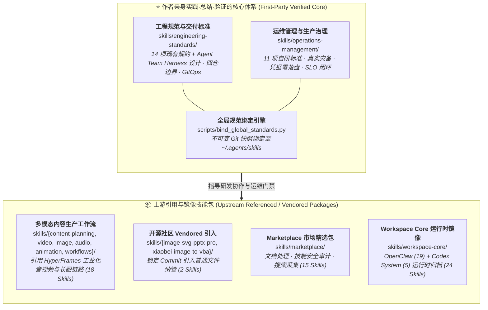

    

# XWorkspace Core Skills

一套面向 **XWorkmate / OpenClaw / Codex** 等 AI Workspace 的生产级规范体系与技能聚合库。

> [!IMPORTANT]
> ### 🎯 核心定位与架构原则
> 
> 本仓库的核心价值，在于沉淀两大自研治理体系：现有 25 项一方规范条目，其中 23 项由仓库徽标列为 Author Verified；Agent Team Harness 是新增的协作设计契约，尚待运行验收，不计入已验证数量：
> 
> 1. ⭐ **[工程规范与交付标准 (`skills/engineering-standards/`)](docs/engineering-standards.md)**（14 项自研核心工程规约）
> 2. ⭐ **[运维管理与基础设施治理 (`skills/operations-management/`)](docs/operations-management.md)**（11 项自研运维标准）
> 新增功能泳道规范为设计契约，尚无实际部署验收。三权分立规范来自实际权限审查；规范建立与校验通过，不代表生产业务降权、rootless 迁移和审计身份隔离已完成。
> 
> 配套自研了 **[版本化全局规范绑定引擎 (`scripts/bind_global_standards.py`)](docs/global-agent-standards.md)**，通过 Git Detached Worktree 技术将已纳入绑定清单的核心规范以不可变快照锁定并注入本机 `~/.agents/skills`，彻底杜绝环境与分支切换漂移。
> 
> **除上述作者实践验证的两大核心规范体系外，仓库内的其余能力域（内容生产工作流、Marketplace 市场生态、OpenClaw/Codex 运行时包等）均为引用或镜像自上游开源社区与官方运行时的技能包**，作为统一 Workspace 的分发与使用聚合层。

---

## 仓库架构全景：实践验证核心 vs 上游引用生态

---

## 📊 全盘扫描与更新结果概览

| 维度 | 扫描前（旧 README） | 扫描后（更新后） | 变动说明 |
|---|---|---|---|
| **纳管 Skill 文件总数** | 31 个 | **86 个** | 按仓库 `skills/` 下的 `SKILL.md` 文件递归计数；本次新增 Agent Team Harness 1 项 |
| **能力域分类** | 8 个（缺漏 marketplace） | **10 大能力域** | 补全 Marketplace 扩展与分类边界，确立自研核心与上游引用分层 |
| **工程规范 (Engineering)** | 12 个 | **14 项现有规范 + 1 项待验收 Harness 设计** | 置顶并串联 `agent-team-harness`、`harness-workflow` 与工程研发交付规范 |
| **运维管理 (Operations)** | 仅文字提及 2 个，无表格 | **11 项完整导航表** | 呈现自研运维标准，覆盖系统/DB 身份隔离、灾备、统一 Observability 架构、凭据治理与 SLO 标准 |
| **市场扩展 (Marketplace)** | 0 个（完全缺失） | **15 个完整导航表** | 上游引用：补全 Office 文档处理、安全审查、Wan 多模态模型、实时翻译等 |
| **运行时核心 (Workspace Core)** | 仅简要文字说明，无清单 | **24 个（19 OpenClaw + 5 Codex）** | 上游镜像：建立完整的双层来源清册、导航索引与刷新机制 |
| **文档与媒体解耦** | 耦合媒体动图与个人账号 | **全面剥离解耦** | 彻底剥离独立演进的动图预览与个人账号信息，保持规范库纯粹专注 |
| **单元测试与门禁验证** | - | **10 项测试全通过** | 运行全量单元测试，确认视频构建流水线与全局绑定工具健康度 100% |

---

## 📖 核心文档导航与详细索引

所有详细规范清单、解决的实战痛点与上游技能包清册均已拆分整理至 `docs/` 目录，供深入查阅：

| 文档分类 | 覆盖范围与内容要点 | 快速入口 |
|---|---|---|
| 🌟 **工程规范与交付标准** | 详细展示作者实践总结的 14 项硬核研发规约全景表、解决的痛点及落地执行原则 | [📖 `docs/engineering-standards.md`](docs/engineering-standards.md) |
| 🌟 **运维管理与基础设施治理** | 详细展示展示 11 项运维标准、灾备恢复演练与故障闭环原则 | [📖 `docs/operations-management.md`](docs/operations-management.md) |
| 🔗 **全局规范绑定引擎** | 详解如何使用 `scripts/bind_global_standards.py` 将核心标准以不可变 Git 快照绑定至本机 `~/.agents/skills` | [📖 `docs/global-agent-standards.md`](docs/global-agent-standards.md) |
| 📦 **上游引用生态技能包** | 涵盖内容生产（18）、Marketplace 市场精选（15）与 Workspace Core 运行时镜像（24）的完整分类表格 | [📖 `docs/upstream-skills-catalog.md`](docs/upstream-skills-catalog.md) |
| 🛡️ **质量验证与工程支持** | 单元测试运行方法（`unittest`）、Release 分支门禁规范、产物隔离契约（`artifact-ignore.md`）与示例工程模板 | [📖 `docs/quality-and-engineering.md`](docs/quality-and-engineering.md) |

## 新增：Agent Team Harness

[团队协作技能](skills/engineering-standards/agent-team-harness/SKILL.md)定义工具中立的 TaskSource/Executor/CoordinationStore/KnowledgeIndex/ArchiveStore 契约；[工程主控流](skills/engineering-standards/harness-workflow/SKILL.md)继续拥有研发闭环，运维副作用由对应 operations-management 标准治理。XWorkspace profile、配置样例和 schema 仅为待验收设计，不宣称运行时已实现。

## 新增：合并前功能泳道发布

[工程技能](skills/engineering-standards/feature-lane-release-workflow/SKILL.md)与[运维生命周期](skills/operations-management/capacity-cost-and-resource-lifecycle/references/feature-lane-lifecycle.md)协同覆盖：关联 PR → 固定构件 → 独立泳道 → SIT → 冻结候选做 UAT → 组合验证 → 合并 → 归档回收。新增规范尚未进行真实部署验收；不自动更新本机全局规范绑定。
