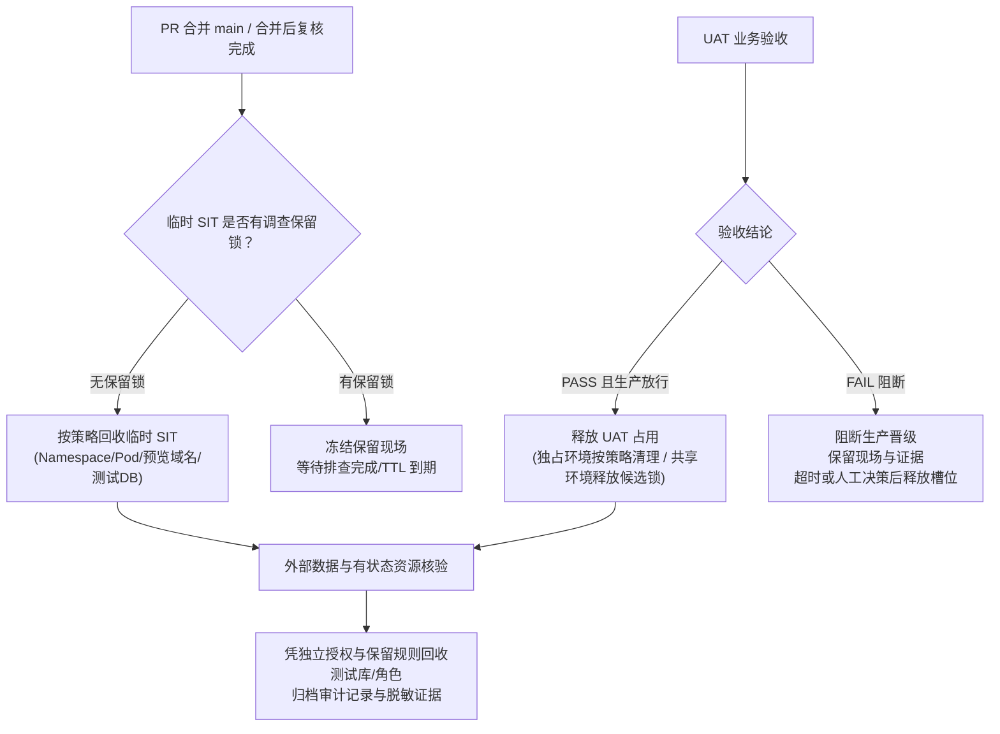

# 环境租约、回收与数据身份契约

本文档是[功能泳道发布工作流](../SKILL.md)的运维与环境生命周期执行契约（附件 3）。涵盖 UAT 共享租约模型、资源分阶段回收、并发保护、数据库三权分立与 Schema 变更规范。

---

## 一、UAT 拓扑与共享租约模型

SIT 采用与 PR 绑定的临时独立环境/namespace；UAT 则根据资源与架构选型支持三种运行拓扑：

| 拓扑模式 | 适用场景 | 候选与生命周期归属 | 部署与准入控制 |
| --- | --- | --- | --- |
| **独立独占 UAT** (`isolated-per-feature`) | 重大特性、架构重构、专属集群/命名空间隔离需求 | 单独绑定该 `featureId`；业务验收通过并完成合并复核后随功能生命周期归档释放 | 专享独立域名与资源配额，无需排队 |
| **共享槽位排队** (`shared-slot-queue`) | 固定非生产集群/Serverless 共享 UAT 环境；资源受限或需要固定的外部对接桩 | 轮流绑定当前正在验收的单个 `featureId` 或合并候选；验收期持有**候选锁** | 后续 main 合并产生的新构建**严禁自动覆盖**正在验收的候选；新候选进入**晋级排队队列** |
| **组合发布候选** (`composite-release-candidate`) | 多个已合并特性按发版窗口统一进入 UAT 验收 | 属于**组合发布候选 (Composite Release Candidate)**，分配全局组合版本号与组合指纹；不单方面归属于某个 feature ID | 每次组合更新须重新生成不可变清单与组合指纹，重跑组合回归 |

### 共享 UAT 占用租约与晋级队列机制

在 `shared-slot-queue` 模式下，发布编排器必须执行以下防抢占与排队规则：

1. **占用租约 (Lease & Heartbeat)**：
   - 候选部署到共享 UAT 时，由编排器分配租约凭证：`leaseHolder`（feature ID 或 release run ID）、`leaseToken`、`leaseExpiresAt`。
   - 活跃验收过程需按心跳（如 30 分钟）续约；若无活动且租约超时，系统发出告警并标记可释放。
2. **候选锁 (Candidate Lock)**：
   - 只要租约有效，UAT 状态即为 `LOCKED_VERIFYING`。
   - **禁止抢占**：此期间任何其他 PR 的合并或 CI 自动化构建，不得触发对共享 UAT 的部署更新。
3. **晋级排队队列 (Promotion Queue)**：
   - 当 UAT 处于锁定状态时，后续合并到 main 的代码仍可在 CI 构建中生成不可变镜像与候选清单，但在编排器中排入 `pending_promotion_queue`。
   - 仅当当前验收出具最终结论（PASS 释放 / FAIL 进入排查锁或放弃）并显式执行 `release-slot` 后，队列中的下一就绪候选方可出队部署。

### 4. Serverless 持久保存 UAT 编排与生命周期 (`serverless-orchestrator.yml`)

当 UAT 运行平台选择 Serverless（GCP Cloud Run + Cloudflare）时，采用专用的受控编排流水线发布并实现**持久保存**：

- **受控编排入口**：由 `ai-workspace-infra/platform-ops-toolkit/.github/workflows/serverless-orchestrator.yml` 统一调度。
- **持久保存语义**：
  - **环境稳定性**：Serverless UAT 不是随 PR 创建和销毁的临时 namespace，而是具备持久域名（`dns_mode: uat-records`）与固定数据基线的**持久保存环境 (Persistent UAT)**。
  - **按版本更新**：每次发布通过 `operation: deploy`（或附带受控迁移 `deploy+migrate`）部署不可变镜像版本标签（`tag_ref`），仅更新 Cloud Run Revision 和边缘 Worker，不推倒重建云资源。
  - **编排互斥锁**：流水线通过 `concurrency.group: serverless-${{ inputs.vault_env_path || 'uat' }}` 在 GitHub Actions 层面强制串行化，天然提供发布锁。
- **候选锁与释放协作**：
  - 业务验收期间，持有 UAT 候选锁（`candidateLock: LOCKED_VERIFYING`），禁止新的 main 合并触发 `serverless-orchestrator.yml` 换版。
  - 验收通过或失败排查结束后，仅释放槽位租约（`release-slot`），保持 Serverless 基础服务和数据库持续运行，等待排队中的下一个候选更新。

---

## 二、资源分类与分阶段回收契约

`featureId` 是生命周期的追踪单元，但不意味着所属所有资源必须在同一时间点一律全量删除。必须区分资源属性与生命周期阶段：

### 1. 分阶段回收与资源分层保留规则

| 资源/实体层级 | 对象范畴 | 生命周期策略 | 回收与保留契约 |
| --- | --- | --- | --- |
| **审计实体** | **`featureId` 及发版回执** | **【永久归档保存】** | 功能 ID、关联 PR 列表、不可变构建清单、SIT/UAT 测试回执与审批记录永久归档保存于泳道外，绝不随运行环境删除而丢失，供生产回溯与合规审计。 |
| **宿主环境** | **K3S - Dev V5 主机环境** | **【默认保存】** | 宿主节点、K3s 运行时、公共网关 Ingress、基础监控与集群级服务**默认长期保存在线**；**除非收到明确的显式关停授权指令，严禁因特性泳道回收而触碰或停用宿主主机环境**。 |
| **临时泳道** | **临时 SIT Namespace ＋ 特性域名** | **【完成测试后释放】** | PR 完成自动化测试并合并至 main，合并后复核完成且无排查保留锁时，临时 Namespace、特性域名（`*.preview.example.com`）及临时测试 DB **按策略安全释放回收**。 |
| **UAT 环境** | **Serverless 持久 UAT** | **【持久保存】** | 由 `serverless-orchestrator.yml` 调度发布；业务验收通过或失败排查结束后，**仅释放租约锁与槽位占用**，底层 Cloud Run、Cloudflare 接入与数据基线长期持久保存。 |
| **外部资源** | **测试 Database、前缀与沙箱凭据** | **【按授权与保留策略清理】** | 临时独占 Database 与应用角色凭授权清理；共享实例、对象存储归档与审计日志遵循Retention Policy 保留。 |

### 2. 状态互斥与并发保护 (Concurrency Guard)
为避免定时任务（TTL Reaper）与业务部署、人工续租产生竞态条件：
- **版本校验 (Lease Version / CAS)**：每次环境租约变更、部署、续约或回收均包含 `leaseVersion` 递增。
- **互斥规则**：
  - 当状态为 `DEPLOYING` 或 `LOCKED_VERIFYING` 时，TTL 回收任务必须跳过或重入等待，禁止强行删除。
  - 回收前必须向编排器原子抢占 `RECYCLING` 锁。如果租约已被续期（`leaseExpiresAt` 延长），回收操作安全终止。

---

## 三、数据与身份安全契约

在任何 SIT 或 UAT 环境中，必须杜绝“所有服务共用一个高权限超级账户（如 postgres / sa）”。每条泳道和环境必须落地三权分立身份模型：

### 1. 三权分立角色矩阵

| 身份类型 | 角色定位 | 凭据注入途径 | 最小权限范围 | 禁令与审计 |
| --- | --- | --- | --- | --- |
| **业务运行身份** (`app_role`) | 容器或无服务器函数实际业务进程运行身份 | Vault 动态租约 / K8s Secret | 仅限本服务特定 schema/表数据的 DML（`SELECT`, `INSERT`, `UPDATE`, `DELETE`） | **严禁 DDL**；严禁访问同库中其他微服务的私有表；严禁跨库查询 |
| **受控迁移身份** (`migrator_role`) | CI/CD 编排器驱动的迁移 Job / Init Container | 短期临时凭据 / OIDC 动态发放 | 拥有目标 schema 的受限 DDL（`CREATE TABLE`, `ALTER TABLE`, `ADD COLUMN`, `CREATE INDEX` 等） | 仅在部署/迁移阶段存在；应用业务 Pod 启动前凭据作废；禁止用于业务查询处理 |
| **独立审计只读身份** (`audit_reader`) | 平台巡检、健康探测与验收对账工具 | 平台只读凭据 | 目标环境全局对象的只读权限（`SELECT`），仅用于一致性校验与数据核算 | **严禁任何写入或修改**；查询必须脱敏 |

### 2. 常规 Schema 变更规范 (非代际平滑演进)
非代际迁移的普通日常数据表变更，必须遵循以下执行契约：
1. **执行者与时机**：由受控 CI/CD 流水线以独立 Migration Job 形式在应用新版本 Pod 启动前执行，不得由业务应用容器在启动主进程时自动执行 DDL。
2. **向前兼容性 (Expand-Contract 原则)**：
   - 第一阶段（Expand）：只允许做兼容性扩张，如新增可空列（Nullable）、带默认值列、新建兼容表。此阶段旧版本代码与新版本代码均可正常读写。
   - 第二阶段（Deploy）：部署新版本应用代码，切换至新字段或新逻辑。
   - 第三阶段（Contract）：在后续独立发版窗口确认无旧版本回退需求后，再执行收缩变更（如删除弃用列、清理冗余索引）。
3. **幂等性与可重试性**：
   - 所有 SQL 迁移脚本必须具备幂等保护（例如 `CREATE TABLE IF NOT EXISTS`, `ALTER TABLE ... ADD COLUMN IF NOT EXISTS`，或基于迁移版本表如 Flyway / Goose / Atlas 的事务锁）。
   - 脚本重新运行不能导致数据损坏或报错中断。
4. **失败阻断与现场保护**：
   - 迁移脚本退出码非 0 时，部署流水线立即进入 `BLOCKED` 状态，不得启动新版应用 Pod。
   - 记录具体错误 SQL 与执行日志；**严禁静默忽略 DDL 失败**。

### 3. SIT 临时泳道与 UAT 持久保存环境的数据能力分层

| 维度 | SIT 临时特性泳道 (`feature-<id>-sit`) | UAT 持久保存环境 (`serverless-orchestrator` / `web-saas-uat`) |
| --- | --- | --- |
| **职责与业务绑定** | **仅承载**基于 GitHub Issues / Projects 记录的 `feature ID` 关联的多仓库 PR；执行闭环：关联多仓 PR → 临时 Namespace＋特性域名 → 自动测试 → 门禁合并 main | 承载合并 main 后的持久业务验收，由 `serverless-orchestrator.yml` 调度发布；或明确指定的冻结候选验收 |
| **运行平台与入口** | Dev K3s 集群，独立临时 Namespace ＋ 特性独立域名（`*.preview.example.com`） | Serverless（GCP Cloud Run + Cloudflare）或固定集群，持有持久 UAT 域名（`dns_mode: uat-records`） |
| **最新 Schema 重建** | **【允许重建】**：为彻底验证分支变更，允许按当前分支最新 SQL 脚本重建全部表结构，追平至最新 schema version | **【严格受控】**：仅允许采纳 expand-only 兼容基线或经审查的向前兼容 `.up.sql` 单步迁移，禁止破坏性重建 |
| **数据库初始化** | **【允许初始化】**：允许为每个特性泳道分配独立 Database，清空并初始化全新隔离测试 DB（Init DB）与种子数据（Seed） | **【禁止推倒重置】**：持久保存业务验收基线数据与状态；严禁自动执行逆向回滚脚本（Down migration） |
| **生命周期与回收** | 临时环境；PR 合并至 main 后，随临时 namespace 彻底回收清理 | **持久保存**；验收完成后仅释放候选锁与租约槽位，环境、数据库与 DNS 稳定留存 |

---

## 四、异常处理与合并后 UAT 失败闭环

在 `postmerge-uat` 模型中，针对 UAT 验收失败必须有清晰、可执行的流转与退出机制：

1. **阻断生产放行**：
   - 无论合并前还是合并后，一旦 UAT 验收结论为 `FAIL`，编排器必须强制在发版门禁打上阻断标记，严禁该候选版本晋级预发或生产。
2. **保留现场与证据提取**：
   - 触发排查保留锁，保留当前环境的 Pod 日志、堆栈转储、数据库现场与测试回执；
   - 共享 UAT 槽位在设定排查缓冲期内（如 2 小时）保持保留，供责任人取证；超时后自动提取日志快照并释放槽位给排队队列。
3. **修复与回退决策分支**：
   - **分支 A（正向修复 PR）**：若属于业务逻辑轻微缺陷，由功能责任人迅速提交修复 PR。该 PR 必须重新进入临时 SIT 运行集成验证；合并入 main 后生成新的 revision，在 UAT 重新进行定向回归。
   - **分支 B（受控 Revert）**：若缺陷严重破坏底层协议或阻塞其他并行功能的发版，责任人发起对已合并 PR 的受控 Revert PR。合入 main 后部署恢复基线版本。
4. **数据库保护铁律**：
   - **严禁将应用层 UAT 失败或应用回滚自动解释为数据库执行逆向回滚脚本（Down migration）的授权**！
   - 应用回滚后，已执行的向前兼容 DDL 保持原样；如果产生脏数据，必须由 DBA 与数据负责人走专门的已审批数据订正流程。
