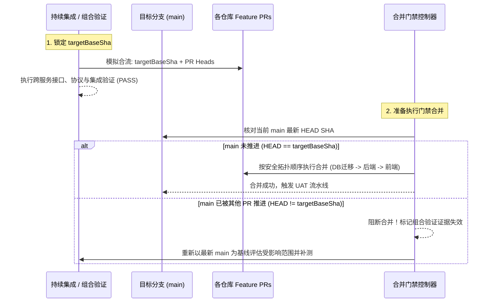
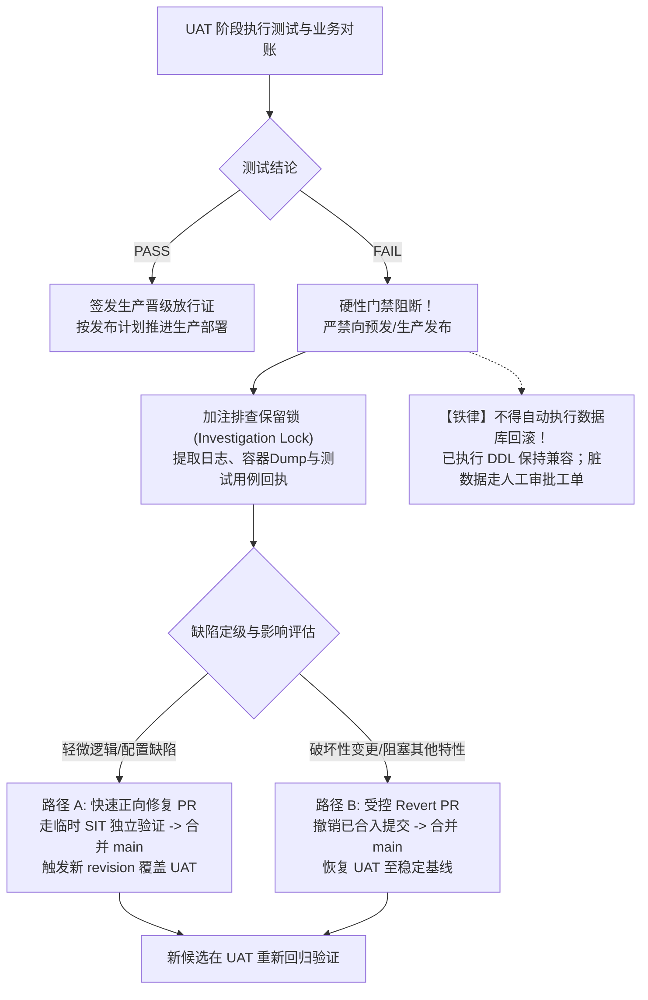

# 阶段、门禁与证据失效契约

本文档是[功能泳道发布工作流](../SKILL.md)的核心执行规范（附件 2）。分别定义两种发布模型的流转阶段、准入门禁、证据复用准则、合并瞬间约束以及 UAT 失败闭环。

---

## 一、双发布模型阶段与门禁矩阵

阶段流转顺序由所选模型决定。默认采用 `postmerge-uat`；仅在用户明确指定时启用 `premerge-uat`。

| 阶段 | 默认模型：`postmerge-uat` 放行门禁 | 明确指定：`premerge-uat` 放行门禁 | 失败、变化或阻断时的处理路径 |
| --- | --- | --- | --- |
| **1. 定义功能** | owner、feature ID、必需/可选 PR 集合、目标分支、SIT/UAT 运行拓扑与平台、测试数据与执行授权就绪 | 相同 | 缺少必要信息保持 `BLOCKED`，先完成发现与补全 |
| **2. 构建候选** | 各仓库 PR head SHA、不可变构件（镜像 digest、Chart 版本、Config SHA）齐备并生成完整候选指纹 | 相同 | 构件未齐备严禁宣称可部署；声明 hash 不代替候选指纹 |
| **3. 部署临时 SIT** | 在 Dev 集群/节点创建临时独立 namespace，完成每服务独立身份与测试库绑定，实际运行 digest 对账无漂移 | 相同 | 不得静默回落基线掩盖故障；缺少运行对账禁止进入测试 |
| **4. SIT 阶段验证** | 接口契约、多服务集成通信、数据库向前兼容 Schema 迁移及核心回归用例 PASS | 相同 | 失败时由 PR 修改生成新 revision 重新部署与验证 |
| **5. 组合基线验证** | 绑定验证开始时固定的目标分支 SHA，执行**目标分支基线与 PR 的合成结果验证**通过 | 冻结当前候选清单，执行合成结果验证及跨仓兼容分析通过 | 目标分支在验证期间发生推进，须重新评估受影响范围；必要时重跑组合验证 |
| **6. 阶段前/后 UAT** | *(本模型在合并后执行，本阶段跳过)* | **合并前执行 UAT**：冻结候选部署到 UAT 槽位/独立环境，完成端到端业务与真实交互验收 | UAT 失败立即阻断合并；修改产生新候选并从 SIT 阶段重新验证 |
| **7. 门禁合并 main** | 授权、必需 CI check、Code Review 全部通过，依跨仓库安全顺序（DB 迁移先行 → 后端 → 前端）依次合并 | 相同；合并时重新比对目标分支最新 HEAD，确认与组合验证基线一致 | 部分仓库合并失败立即触发 **Stop Point**，责任人介入排查；严禁半合并状态发布 |
| **8. UAT / 合并后复核** | **合并后执行 UAT**：由 main 触发受控编排流水线（如 `platform-ops-toolkit/.github/workflows/serverless-orchestrator.yml`，设置 `vault_env_path: uat`、`dns_mode: uat-records`），核对真实 merge SHA 与新候选构件，部署至 Serverless 持久保存环境并完成业务验收全通过 | **合并后复核**：核对真实 merge SHA 构件与合并前 UAT 候选指纹一致，执行关键健康探活与冒烟回归 | 验收通过方可打上生产放行标；**若 UAT 失败，严禁晋级生产**（转入第四节失败闭环） |
| **9. 归档与环境回收** | **feature ID 及测试证据永久归档保存**；合并复核完成且无排查锁时，**按策略释放临时 SIT Namespace 与特性域名**；**K3S - Dev V5 主机环境默认保存**（除非显式关停）；Serverless UAT 持久保存，仅释放候选锁与槽位租约 | 相同；临时 SIT 与持久环境分别按分层生命周期规则处理 | 外部资源清理凭独立授权；部分清理失败保留可重试状态 |

---

## 二、证据复用与运行对账契约

“同一构件沿用有效证据”必须具备严格的判定边界。绝对禁止仅因“镜像 tag 没变”就无条件跨阶段继承 PASS。

### 1. 证据复用的“六维有效性”判定
历史阶段（如 SIT）的测试证据，仅在以下六项条件**同时满足**时，方可在 UAT 阶段声明复用；每次复用必须在回执中记录来源 `verificationRunId` 及适用性理由：

1. **候选构件一致**：源代码 Commit SHA、容器镜像不可变 Digest、配置 ConfigMap/Secret 模板 SHA 完全无变更；
2. **目标环境配置等价**：环境变量、运行架构、依赖系统参数在逻辑与安全语义上严格等价；
3. **依赖版本基线匹配**：上下游共享基线服务、消息中间件版本未发生不兼容变更；
4. **数据与 Schema 前提未变**：数据库基础 Schema 版本及初始测试数据集形态保持一致；
5. **测试用例范围边界适用**：
   - *允许复用*：纯业务算法用例、通用 API 单元/契约用例；
   - *严禁复用（必须在当前环境重新实测）*：**网络域名与入口路由**、**容器运行身份与 RBAC 绑定**、**数据库连接与权限隔离**、**第三方外部沙箱/回调地址**；
6. **时效性处于 TTL 内**：测试证据在有效的验收窗口期内，未超过失效时效。

### 2. 跨环境运行对账事实不可替代
- 即使镜像完全相同，从临时 SIT 迁移或晋级到 UAT 环境后，**旧 SIT 的运行对账证据绝不能代替 UAT 的实际运行对账**。
- UAT 部署完成后，必须重新采集目标节点运行事实（Runtime Facts），提取实际运行的 Pod/Task imageID 与状态，生成新的部署回执。

### 3. 多架构镜像 (Multi-arch) 的 Digest 比对规范
- 现代化容器镜像通常采用 OCI Image Index / Docker Manifest List（多架构索引）。
- 构建阶段输出的声明 Digest 往往是多架构 Index Digest；而节点容器运行时（如 containerd / CRI-O）拉取并在本地呈现的 `imageID` 可能是平台特定架构（如 `linux/amd64` 或 `linux/arm64`）的子 Manifest Digest。
- 对账引擎**不得简单使用单纯的字符串全等比对**，而必须支持：
  1. 通过 Registry API / Crane / Skopeo 解析 Index 与平台子 Manifest 的对应关系；
  2. 若运行 `imageID` 与声明 Index Digest 不相等，但能在其子架构清单中找到明确的父子映射且架构匹配，视为对账一致并记录架构匹配事实；
  3. 无法建立有效映射或架构不符时，判定为漂移并阻断。

---

## 三、组合验证与合并瞬间约束

跨仓库功能涉及多 PR 时，组合验证是防止“各自单测通过但合流破坏”的屏障。必须保证合并动作与验证对象的一致性：

1. **验证基线与对象**：
   - 验证开始时，编排器必须显式记录并锁定目标分支基线 SHA（`targetBaseSha`）。
   - 组合验证的测试对象必须是：**目标分支基线与全部必需 PR 的合成模拟结果 (Simulated Merge Result)**，而非各自孤立的 PR Head。
2. **合并瞬间核对 (Merge-Moment Check)**：
   - 门禁控制器在执行合并的**物理瞬间**，必须重新读取目标分支最新的全局提交 SHA。
   - 若目标分支已由其他分支合并而向前推进，编排器必须中止合并动作，并将当前的组合验证证据标记为 `INVALIDATED_BY_BASE_DRIFT`；
   - 评估目标分支的变更内容是否触及本功能的依赖链路：若有重叠或潜在冲突，必须重新拉取最新基线运行组合回归；若完全无关，出具影响评估报告并刷新基线 SHA。
3. **跨仓库合并顺序拓扑**：
   - 多仓库合并严禁乱序发起，必须遵循系统稳定性依赖顺序：
     1. **数据与 Schema 仓库**：向前兼容 DDL 迁移先行就绪；
     2. **核心业务与下层 RPC 服务**：提供兼容协议的服务先合并；
     3. **上层网关、BFF 与前端门户**：消费端最后合并。
   - 任何一步都必须满足对旧系统正在运行节点的向前兼容。
4. **部分合并失败的出口与止损**：
   - 跨仓库合并不是分布式原子事务。若仓库 A 合并成功，但仓库 B 因代码冲突或 CI check 抖动失败：
     - **立即触发 Stop Point**：终止后续仓库的合并动作；
     - **责任人归属**：通知当前 Feature Owner 与发布 On-call 工程师；
     - **现场保持**：临时 SIT 与当前构建现场不得销毁；
     - **修复路径**：若属于非致命临时故障，针对失败仓库提交补丁 PR 并在 SIT 验证后补齐合并；若涉及根本性逻辑破坏，对已合并的仓库 A 立即实施受控 Revert PR，恢复基线一致性。

---

## 四、合并后 UAT 失败闭环与出口

在 `postmerge-uat` 模型中，代码已经合入 main 分支，但尚未发布生产。UAT 验收出现故障时的应对契约如下：

1. **绝对阻断生产晋级**：
   - UAT 阶段结论为 `FAIL` 时，CI/CD 编排器自动关闭生产发布通道，相关候选版本被标记为 `UNACCEPTABLE_FOR_PROD`，禁止任何形式的人工强制跳过。
2. **排查锁与证据持久化**：
   - 自动生成 `investigationLock`，防止临时环境被定时清理或被后续非生产构建静默冲掉；
   - 自动化导出脱敏后的失败测试用例回执、相关 Pod 错误堆栈、分布式追踪 Trace ID、网络对账差异，并持久化到泳道外审计目录。
3. **修复流转必须重走门禁**：
   - 正向修复 PR 必须在临时 SIT 环境中重新验证通过后，方可合并至 main 分支；
   - 修复合入后产生新的候选 Revision，UAT 环境重新执行对账与定向回归。
4. **共享槽位释放规则**：
   - 若故障无法在排查锁窗口（默认 2 小时）内解决，Feature Owner 必须确认证据采集完成，并主动调用释放命令或由编排器将共享 UAT 槽位置为待维护状态，让出资源给晋级排队队列，避免全局发版流水线死锁。
5. **严禁数据库自动逆向回滚**：
   - 数据库必须坚持只前进不破坏原则；严禁在流水线中配置自动触发的 `migrate down`。
   - 所有已生效的 DDL 变更保持存在；若测试过程写入了错误数据，仅限在业务沙箱库范围内通过经评审的订正脚本处理。
