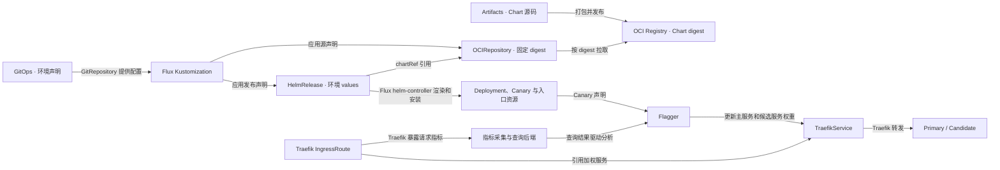

# Kubernetes 渐进发布

适用于以 Flux 和 Helm 交付、由 Flagger 和 Traefik 执行金丝雀发布的 Kubernetes 服务。沿用[多环境发布规范](../SKILL.md)中的升级分类与环境门槛。未建立流量和指标门槛的服务，只能在变更类别允许且已有受控发布路径时使用滚动发布。已启动的金丝雀若丢失指标，按失败处理。

## 制品、调谐与运行链路

`OCIRepository` 和 `HelmRelease` 是 Flux Kustomization 应用的两份声明。`OCIRepository` 由 Flux source-controller 调谐，从注册表取回固定 digest 的 Chart。`HelmRelease` 通过 `chartRef` 消费该 Chart，由 helm-controller 结合环境 values 执行安装或升级。

公共模板、默认值和 Chart 依赖变更从 Artifacts 源头发布新 Chart。只调整环境配置或应用镜像时，更新 GitOps 中对应的 HelmRelease values，沿用已验证的 Chart digest。每次推广记录应用和 Chart 的实际 digest，分别确认 Flux 已对账、Helm 已部署、Flagger 已提升和 Traefik 已按权重转发。

## 声明与控制器归属

| 归属 | 声明与验证 |
| --- | --- |
| GitOps / Flux Kustomization | 固定环境交付的 Git revision，按生命周期组织资源，并声明 source、path、依赖、等待和超时。 |
| OCIRepository / HelmRelease / Chart | GitOps 固定 `OCIRepository.spec.ref.digest`，HelmRelease 通过 `spec.chartRef` 引用该源。Chart 管理可复用模板和默认值，环境声明提供镜像 digest、域名、TLS 引用、指标地址和分析阈值。核对实际调谐的 Chart digest 与运行镜像。 |
| Flagger / Traefik | Flagger 管理 primary、candidate 及生成的加权 TraefikService。Traefik 的灰度入口和相关别名引用该加权服务。GitOps 和 Helm 管理声明的 Canary、路由和模板，运行时权重及 Flagger 生成的资源由 Flagger 管理。 |

参考 [Flux HelmRelease](https://fluxcd.io/flux/components/helm/helmreleases/#chart-reference) 和 [Flagger Traefik 发布](https://docs.flagger.app/tutorials/traefik-progressive-delivery)。

活动入口与退役入口按生命周期拆分，退役入口保留独立的回退声明。优先在活动单元启用整体就绪检查。使用 `wait: true` 时，Flux 会忽略同一 Kustomization 的 `healthChecks`。跨单元依赖用 `dependsOn` 表达。迁移既有资源前，核对 Flux inventory 与 prune 行为，明确交接顺序，验证原单元移出声明时不会删除新单元仍需使用的对象。避免两个单元同时调谐同一对象。 [Flux Kustomization](https://fluxcd.io/flux/components/kustomize/kustomizations/)

## 推广与回退

1. 固定应用源码 SHA、环境 GitOps revision、Chart digest、镜像 digest 和回退版本。先在 SIT 验证加权入口、指标分析和自动回退，再按既有环境策略推广同一构件。按变更范围验证数据兼容、关键用户路径、旧客户端和权限边界。对声明零 SQL schema 变更的升级，对比升级前后的 schema，并核对启动过程是否执行迁移。
2. 发布前，核对目标环境的 Flux 单元均已应用预期 revision 且 Ready，相关 HelmRelease Ready。核查域名和别名的可信 TLS、关键路径以及实际加权后端。确认没有更高优先级的路由绕开候选权重。按[金丝雀指标验收](../../../operations-management/observability-slo-and-alerting/SKILL.md#canary-metric-acceptance)确认查询链路可用，并在候选接到受控流量后验证实际样本，再扩大权重。
3. 按接口依赖顺序逐项推广。例如先 Accounts，再 Portal。记录每一阶段的权重、候选样本、错误率和判断结果。确认 Canary 已提升，且 primary 实际运行预期镜像、关键路径健康后，再推进依赖方。PR 合并、Flux Ready 和流量验收分别记录。
4. 分析失败时，验证 Flagger 已将流量退回 primary，随后通过 GitOps 恢复或修正期望版本。需要回退已推广的组合版本时，按依赖逆序恢复受影响的服务，例如先 Portal 再 Accounts。恢复到记录的固定版本后，再核对 Flux、镜像、真实请求及指标。
