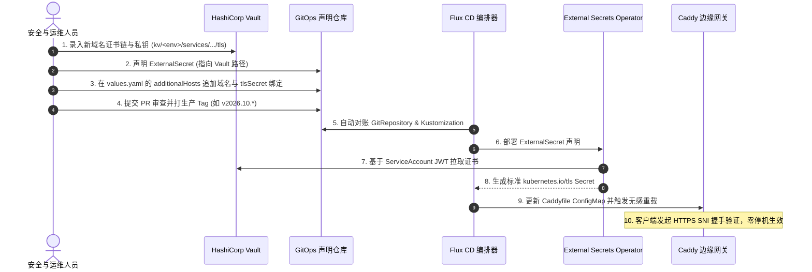

# Vault ESO TLS 证书同步与边缘网关治理规范

> **规范状态**: 核心自研验证资产 (Verified Production Standard)  
> **适用范围**: Kubernetes (PROD / UAT / SIT) 多云与混合云集群、HashiCorp Vault KV v2、External Secrets Operator (ESO)、Caddy / Ingress 边缘网关  
> **依赖关联**: [secrets-identity-and-access-governance](../secrets-identity-and-access-governance/SKILL.md)、[network-dns-tls-edge-management](../network-dns-tls-edge-management/SKILL.md)

---

## 核心架构原则与安全红线

1. **凭据零明文、零代码库暴露、零手动注入**：
   - 严禁在代码库、GitOps 配置、CI/CD 流水线变量或构建产物中包含 TLS 私钥明文。
   - 严禁通过人工执行 `kubectl create secret tls` 注入证书。
   - 所有环境（PROD / UAT / SIT）的 TLS 公私钥必须统一纳入内部 HashiCorp Vault KV（v2）纳管。
2. **声明式拉取与单一来源对账（GitOps-driven Pull）**：
   - 采用 External Secrets Operator (ESO) 基于 Kubernetes 投影凭据反向从 Vault 拉取，严禁推送式（Push）写凭据。
   - ExternalSecret 资源与网关路由配置必须完全由 GitOps（Flux CD / ArgoCD）不可变版本化管理。
3. **最小特权与工作负载身份隔离（Workload Identity）**：
   - 每一个工作负载（如网关、微服务）必须绑定独立的 Kubernetes ServiceAccount。
   - Vault 鉴权严格限定专属 Audience（如 `vault-<workload>-<env>`），禁止跨命名空间或跨环境共享凭据访问权限。
4. **边缘网关只读挂载与平滑热轮转（Zero Downtime Rotation）**：
   - 网关 Pod（Caddy / Ingress）以最小只读权限（`defaultMode: 288` 即 `0440`）挂载标准 `kubernetes.io/tls` 类型的 Secret。
   - 证书更新由 ESO 定期（如 `5m`）自动同步至 Secret，网关依赖本地文件监听（fsnotify）实现无感平滑热轮载，严禁重启网关或中断在线请求。

---

## 一、全链路架构模型 (Architecture Model)

```mermaid
flowchart TD
    subgraph Layer1_Vault ["1. 统一凭据存储平面 (HashiCorp Vault Raft)"]
        Vault["HashiCorp Vault KV v2 (内部 DNS: https://vault-raft.platform-vault:8200)\n- Path: kv/<env>/services/<namespace>/tls/<domain>\n- Fields: tls_fullchain_pem, tls_key_pem"]
    end

    subgraph Layer2_Identity ["2. 身份与受众鉴权平面 (Workload Identity)"]
        SA["ServiceAccount: web-saas-vault-reader\n(自动注入投影视角 Token)"]
        CA_CM["ConfigMap: vault-raft-ca\n(提供内部 CA 根证书链)"]
        SS["SecretStore: vault-backend\n- Auth: kubernetes (Role: <workload>-<env>)\n- Audience: vault-<workload>-<env>\n- CA: ConfigMap/vault-raft-ca"]
    end

    subgraph Layer3_Reconcile ["3. 声明式对账平面 (External Secrets Operator)"]
        ES1["ExternalSecret: web-saas-tls\n- RefreshInterval: 5m\n- Remote: prod/.../tls"]
        ES2["ExternalSecret: web-saas-brand-tls\n- RefreshInterval: 5m\n- Remote: prod/.../brand-tls"]
        SEC1["K8s Secret: web-saas-tls\n(Type: kubernetes.io/tls)"]
        SEC2["K8s Secret: web-saas-brand-tls\n(Type: kubernetes.io/tls)"]
    end

    subgraph Layer4_Gateway ["4. 边缘服务网关消费平面 (Caddy Ingress / ServiceLB)"]
        SVCLB["K3s ServiceLB / LoadBalancer Service\n(公网 IP: 443 -> 容器端口: 8443)"]
        CADDY["Caddy Gateway Pod\n- auto_https off\n- 挂载: /tls/<cert-name>/ (0440 只读)\n- SNI 匹配 & 反向代理"]
        SVC_BACKEND["内部微服务 / 上游服务\n(accounts / console / billing)"]
    end

    %% 鉴权流
    SA -->|K8s Projected Token| SS
    CA_CM -->|注入内部信任链| SS
    SS -->|mTLS + JWT 验证| Vault

    %% 对账流
    Vault -->|按路径拉取私钥与完整证书链| ES1 & ES2
    ES1 -->|模板化渲染 (creationPolicy: Owner)| SEC1
    ES2 -->|模板化渲染 (deletionPolicy: Retain)| SEC2

    %% 消费流
    SEC1 & SEC2 -->|卷挂载 (defaultMode: 0440)| CADDY
    SVCLB -->|443 TCP 流量分发| CADDY
    CADDY -->|SNI 域名匹配 + TLS 握手终止| SVC_BACKEND
```

---

## 二、标准化资源声明契约 (Contract Specifications)

### 1. Vault KV v2 路径与字段契约

所有证书路径必须遵循“环境-服务-作用域”的分层结构：

```text
kv/<env>/services/<namespace>/tls/<domain-or-role>
```

| 字段名称 | 类型 | 说明与规范 |
| :--- | :--- | :--- |
| `tls_fullchain_pem` | string | 完整的证书链 PEM 格式（包含服务器证书、中间 CA 证书，禁止遗漏中间链）。 |
| `tls_key_pem` | string | 未加密的私钥 PEM 格式（RSA 2048+ 或 ECDSA P-256+）。 |
| `issuer` | string | 签发机构（如 Let's Encrypt, ZeroSSL, Cloudflare, Internal CA）。 |
| `expire_at` | string | 证书到期 ISO8601 时间戳，用于告警巡检。 |

---

### 2. SecretStore 资源契约

```yaml
apiVersion: external-secrets.io/v1
kind: SecretStore
metadata:
  name: vault-backend
  namespace: <target-namespace>
spec:
  provider:
    vault:
      server: https://vault-raft.platform-vault.svc.cluster.local:8200
      path: kv
      version: v2
      caProvider:
        type: ConfigMap
        name: vault-raft-ca
        key: ca.crt
      auth:
        kubernetes:
          mountPath: kubernetes-<cluster-id>
          role: <workload-role>-<env>
          serviceAccountRef:
            name: <vault-reader-sa>
            audiences:
              - vault-<workload-role>-<env>
```

- **安全硬要求**：
  - `server` 必须指向内部集群无公网暴露的 CoreDNS 端点。
  - `caProvider` 强制校验内部 CA 证书，严禁配置 `insecureSkipVerify: true`。
  - `audiences` 强制限定专属受众，防止 JWT Token 被滥用。

---

### 3. ExternalSecret 资源契约

```yaml
apiVersion: external-secrets.io/v1
kind: ExternalSecret
metadata:
  name: <service>-tls
  namespace: <target-namespace>
spec:
  refreshInterval: 5m
  secretStoreRef:
    kind: SecretStore
    name: vault-backend
  target:
    name: <service>-tls
    creationPolicy: Owner
    deletionPolicy: Retain
    template:
      type: kubernetes.io/tls
      engineVersion: v2
      mergePolicy: Replace
      data:
        tls.crt: "{{ .tls_cert }}"
        tls.key: "{{ .tls_key }}"
  data:
    - secretKey: tls_cert
      remoteRef:
        key: <env>/services/<namespace>/tls/<domain>
        property: tls_fullchain_pem
    - secretKey: tls_key
      remoteRef:
        key: <env>/services/<namespace>/tls/<domain>
        property: tls_key_pem
```

- **安全与稳定性参数**：
  - `refreshInterval`: 默认建议 `5m`。平衡 Vault API 调用压力与证书紧急轮换生效时间。
  - `creationPolicy: Owner`: 由 ESO 显式拥有该 K8s Secret 资源，确保版本一致。
  - `deletionPolicy: Retain`: 防止在 CRD 意外重构时立即删除运行中的 K8s Secret，提供网络高可用保底。
  - `type: kubernetes.io/tls`: 渲染为标准 K8s TLS Secret，确保与 Ingress / Caddy / Envoy 100% 兼容。

---

### 4. 边缘网关消费契约（以 Caddy Ingress 为例）

#### (1) Deployment 挂载规范
```yaml
spec:
  template:
    spec:
      containers:
        - name: caddy
          volumeMounts:
            - name: tls-cert
              mountPath: /tls/<cert-name>
              readOnly: true
      volumes:
        - name: tls-cert
          secret:
            secretName: <service>-tls
            defaultMode: 288 # 0440 只读
```

#### (2) Caddyfile 路由与安全防线
```caddy
{
  admin off
  auto_https off        # 核心防线：关闭本地 ACME 弱申请，全部依赖 Vault
  http_port 8080
  https_port 8443
}

https://<custom-domain>:8443 {
  tls /tls/<cert-name>/tls.crt /tls/<cert-name>/tls.key
  
  # 后端业务微服务反代
  reverse_proxy web-saas-frontend:80
}
```

---

## 三、新增域名与证书准入准则 (Domain Onboarding Runbook)

当业务接入全新外部域名时，必须严格执行以下四步闭环操作流程：



### 操作步骤执行清单：

1. **第 1 步：Vault 凭据入库**：
   通过运维受控通道写入 Vault，禁止在终端明文打印：
   ```bash
   vault kv put kv/prod/services/web-saas-k3s-v5/tls/xworktech-com \
     tls_fullchain_pem=@xworktech.com.fullchain.crt \
     tls_key_pem=@xworktech.com.key \
     issuer="ZeroSSL" \
     expire_at="2027-10-28T00:00:00Z"
   ```
2. **第 2 步：GitOps 声明 ExternalSecret**：
   在 `services/<service>/prod/external-secret.yaml` 中增加：
   ```yaml
   - apiVersion: external-secrets.io/v1
     kind: ExternalSecret
     metadata:
       name: web-saas-brand-tls
       namespace: web-saas-k3s-v5
     spec:
       refreshInterval: 5m
       secretStoreRef:
         name: vault-backend
       target:
         name: web-saas-brand-tls
         template:
           type: kubernetes.io/tls
           data:
             tls.crt: "{{ .tls_cert }}"
             tls.key: "{{ .tls_key }}"
       data:
         - secretKey: tls_cert
           remoteRef:
             key: prod/services/web-saas-k3s-v5/tls/xworktech-com
             property: tls_fullchain_pem
         - secretKey: tls_key
           remoteRef:
             key: prod/services/web-saas-k3s-v5/tls/xworktech-com
             property: tls_key_pem
   ```
3. **第 3 步：GitOps values 路由绑定**：
   在 `services/<service>/prod/values.yaml` 中追加 `additionalHosts`：
   ```yaml
   caddy:
     additionalHosts:
       - name: brand-console
         host: xworktech.com
         serviceRole: console
         tlsSecret: web-saas-brand-tls
   ```
4. **第 4 步：不可变发布与自动对账**：
   PR 评审合并后，打上生产环境版本标签（如 `v2026.10.*`），Flux CD 自动拉取更新，ESO 生成 Secret，网关热重载生效。

---

## 四、安全审计、排障与健康巡检 (Troubleshooting & Audit)

### 1. 常用巡检验证指令

* **检查集群内所有 ExternalSecret 同步状态**：
  ```bash
  kubectl get externalsecrets -A -o wide
  # 预期输出: STATUS=SecretSynced, READY=True
  ```
* **检查 SecretStore 连通性与 Vault 状态**：
  ```bash
  kubectl describe secretstore vault-backend -n <namespace>
  # 预期输出: Status: Valid, Conditions: Reason=Valid, Status=True
  ```
* **校验生成 Secret 的证书有效性（非解密只查元数据）**：
  ```bash
  kubectl get secret <service>-tls -n <namespace> -o jsonpath='{.data.tls\.crt}' | base64 -d | openssl x509 -noout -dates -subject -issuer
  ```
* **验证网关外部 SNI 握手与证书匹配**：
  ```bash
  openssl s_client -connect <INGRESS_IP>:443 -servername <DOMAIN_NAME> -showcerts </dev/null 2>/dev/null | openssl x509 -noout -subject -dates
  ```

---

### 2. 经典排障决策树 (Troubleshooting Matrix)

| 异常现象 | 可能原因 | 快速定位与处理动作 |
| :--- | :--- | :--- |
| **`SecretSynced: False` (SecretStore Missing)** | SecretStore 未就绪或 ServiceAccount 无权限 | 检查 `kubectl get secretstore`，确认 `web-saas-vault-reader` 角色是否已在 Vault 的 `kubernetes` auth mount 授权绑上。 |
| **`SecretSynced: False` (Key not found in Vault)** | Vault 内部路径写错或属性名不匹配 | 检查 `remoteRef.key` 路径是否多写或少写了 `kv/` 前缀；确认 Vault 中的 key 是否确为 `tls_fullchain_pem`。 |
| **HTTPS 访问报证书不受信任 (SEC_ERROR_UNKNOWN_ISSUER)** | Vault 中录入的证书缺失中间证书链 | 确认 Vault 中的 `tls_fullchain_pem` 是否包含 CA 签发链；严禁只录入单张叶子证书（Server Cert）。 |
| **HTTPS 访问出现证书域名不匹配 (SSL_ERROR_BAD_CERT_DOMAIN)** | Ingress/Caddy 路由配置与挂载 Secret 不对应 | 检查 `values.yaml` 中的 `tlsSecret` 是否正确映射到该 Host，确认 Caddyfile SNI 分块中的文件路径是否正确。 |
| **证书在 Vault 轮换后网关未更新** | Secret 处于缓存中或网关无热重载机制 | 1. 检查 ESO 的 `refreshInterval`（默认 5m）是否触发；<br>2. 验证 K8s Secret 内容是否已刷新；<br>3. 若网关未监听文件变动，执行平滑重载（如 `caddy reload` 或 rollout restart）。 |
